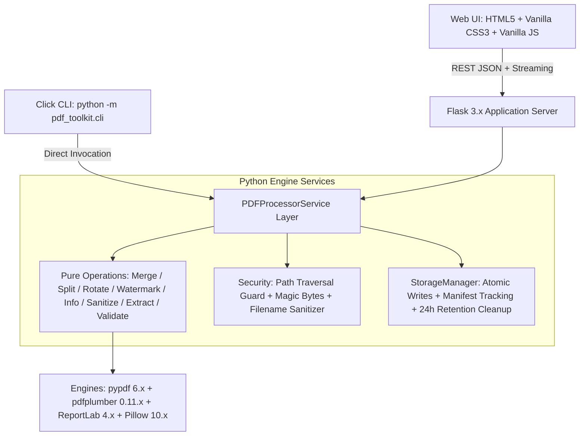

# PDF Utility Toolkit Pro

<p align="center">
  
</p>

<p align="center">
  <strong>Production-Grade Document Automation Engine & Local Privacy Toolkit</strong>
</p>

<p align="center">
  <a href="https://www.python.org/downloads/"></a>
  <a href="https://pytest.org/"></a>
  <a href="https://opensource.org/licenses/MIT"></a>
  <a href="#security-privacy--integrity"></a>
  <a href="#core-capabilities"></a>
</p>

---

> **“Authored a CLI PDF manipulation toolkit executing non-destructive page transformations, merges, and watermarking, extended with a responsive web interface built using Python, HTML, CSS, and vanilla JavaScript.”**

---

## Executive Overview

**PDF Utility Toolkit Pro** is an enterprise-grade document manipulation suite engineered to streamline office document workflows with absolute precision, speed, and privacy. Built strictly using **Python, HTML, CSS, and Vanilla JavaScript**, it delivers a unified dual-interface experience:

1. **Modern SaaS Browser Interface**: Fully responsive, accessible, dark/light theme-ready workspace with zero external UI dependencies.
2. **Click-Powered Command-Line Interface (CLI)**: High-performance automation tool for sysadmins, developers, and headless pipelines sharing the identical service layer.

### Core Value Propositions
* 🛡️ **Zero Third-Party Telemetry**: 100% local processing. No files, metadata, or metrics leave your host machine.
* ⚡ **High Capacity (1 GB)**: Supports documents up to 1 GB in size with chunked streaming and atomic disk operations.
* 🎯 **Non-Destructive Integrity**: Source files are never altered in place. All changes generate verified, standalone assets.
* ⚖️ **Dual-Mode Parity**: Every command in the Web UI has an exact counterpart in the CLI tool.

### Copyright Notice
> **“Copyright Reserved. Made by Harsh Patel.”**

---

## Architecture & Technology Stack

The toolkit strictly adheres to a native stack without bloated Node.js runtimes, TypeScript compilers, or external frontend frameworks.



### Technology Breakdown
* **Backend Runtime**: Python 3.9+ (Standard Library, Flask 3.x WSGI)
* **PDF Processing Engines**: `pypdf` (structure & rotation), `pdfplumber` (character extraction), `ReportLab` (vector watermarks), `Pillow` (image watermarks)
* **CLI Framework**: `Click` 8.x
* **Quality Assurance**: `pytest` 8.x (37 unit, integration, and security tests)
* **Frontend Architecture**:
  * Semantic HTML5 with ARIA accessibility roles
  * Custom Vanilla CSS3 Design System with CSS Custom Properties and hardware-accelerated transitions
  * Capsule Dark / Light mode toggle with `localStorage` persistence and FOUT prevention
  * Vanilla ES6+ JavaScript with zero third-party dependencies

---

## Core Capabilities & Implemented Tools

| Tool | Capability & Architecture | Web & CLI Parity |
| :--- | :--- | :---: |
| **1. Merge PDF** | Combines 2+ documents in user-defined ordering. Validates inputs, handles encrypted documents, and preserves vector fidelity. | `merge` |
| **2. Split PDF** | Splits into individual pages or complex ranges (e.g. `1-3, 5, 8-10`). Generates individual files or ZIP packages. | `split` |
| **3. Rotate PDF** | Rotates all or targeted pages clockwise by 90°, 180°, or 270° without rasterizing text or vectors. | `rotate` |
| **4. Watermark PDF** | Overlays transparent vector text (ReportLab) or branded image logos (Pillow) with real-time canvas preview. | `watermark` |
| **5. PDF Information** | Deep structural inspection: page dimensions (pt, in, mm), rotations, encryption status, PDF version, and text density metrics. | `info` |
| **6. Metadata Sanitizer** | Strips or updates standard properties (Title, Author, Subject, Keywords) with forensic diff tracking. | `sanitize-metadata` |
| **7. Text Extractor** | Extracts selectable character streams via `pdfplumber` with word counts, copy-to-clipboard, and clean `.txt` export. | `extract-text` |
| **8. PDF Validator** | Multi-point structural validation verifying `%PDF` magic bytes, `%%EOF` trailer markers, catalog nodes, and xref integrity. | `validate` |
| **9. Output History** | Dedicated session tracking with instant safe deletion and automatic 24-hour expiration TTL. | `/api/files` |

---

## Project Directory Layout

```text
PDF Toolkit Pro/
├── app.py                      # Flask web application & REST API routes
├── pdf_toolkit/                # Shared Python processing package
│   ├── __init__.py             # Package exports & version metadata
│   ├── config.py               # Settings, storage limits (1 GB), & paths
│   ├── exceptions.py           # Custom exception hierarchy
│   ├── logging_config.py       # Structured logging with secret redaction
│   ├── cli.py                  # Click command-line interface entry points
│   ├── operations/             # Pure PDF processing modules
│   │   ├── __init__.py
│   │   ├── merge.py            # PDF document merging
│   │   ├── split.py            # Page splitting & range parser (1-3,5)
│   │   ├── rotate.py           # 90°/180°/270° clockwise rotations
│   │   ├── watermark.py        # Vector text & image watermarking
│   │   ├── info.py             # Document inspection & dimensional metrics
│   │   ├── metadata.py         # Metadata sanitization & editing
│   │   ├── extract.py          # pdfplumber character extraction
│   │   └── validate.py         # Conformance & parser compliance checks
│   ├── security/               # Validation & sanitization guards
│   │   ├── __init__.py
│   │   ├── sanitizer.py        # Filename & path traversal sanitizers
│   │   └── validation.py       # Magic bytes & PDF header verification
│   └── services/               # Shared business logic
│       ├── __init__.py
│       ├── storage.py          # Atomic writes, manifest tracking, TTL cleanup
│       └── processor.py        # Centralized PDFProcessorService layer
├── templates/
│   └── index.html              # Responsive HTML5 SaaS interface
├── static/
│   ├── css/
│   │   └── style.css           # Vanilla CSS design system & micro-animations
│   ├── js/
│   │   └── app.js              # Vanilla JS client logic & drag-and-drop
│   └── images/
│       ├── logo.svg            # Brand logo icon
│       └── favicon.svg         # Application favicon
├── tests/                      # Automated test suite (37 tests)
│   ├── __init__.py
│   ├── conftest.py             # Synthetic PDF fixtures & storage isolation
│   ├── test_operations.py      # Operations unit tests
│   ├── test_security.py        # Security & sanitization tests
│   ├── test_cli.py             # Click CLI integration tests
│   └── test_web_api.py         # Flask REST API tests
├── uploads/                    # Temporary session upload folder (.gitignore)
├── processed_pdfs/             # Temporary processed asset folder (.gitignore)
├── requirements.txt            # Production dependencies
├── pyproject.toml              # Build & packaging specification
├── .env.example                # Documented configuration template
├── .gitignore                  # Security-first Git exclusion rules
└── README.md                   # Professional project documentation
```

---

## Installation & Quick Start

### 1. Prerequisites
* Python 3.9, 3.10, 3.11, 3.12, 3.13, or 3.14.

### 2. Clone & Environment Setup
```bash
# Clone the repository
git clone https://github.com/<your-username>/pdf-toolkit-pro.git
cd "pdf-toolkit-pro"

# Create a virtual environment
python -m venv venv

# Activate on Windows (PowerShell):
.\venv\Scripts\Activate.ps1

# Activate on Linux / macOS:
source venv/bin/activate
```

### 3. Install Dependencies
```bash
pip install -r requirements.txt
```

### 4. Configure Environment (Optional)
```bash
# Windows
copy .env.example .env

# Linux / macOS
cp .env.example .env
```

---

## Running the Web Interface

Launch the local web server:
```bash
python app.py
```
Open your browser and navigate to:
```text
http://127.0.0.1:5000
```

---

## Command-Line Interface (CLI) Usage

The Click CLI provides headless access to all operations using the identical underlying services.

### Help & Version Information
```bash
python -m pdf_toolkit.cli --help
python -m pdf_toolkit.cli version
```

### 1. Merge Documents
```bash
python -m pdf_toolkit.cli merge report1.pdf report2.pdf appendix.pdf -o merged_output.pdf
```

### 2. Split Document
```bash
# Split into individual pages
python -m pdf_toolkit.cli split doc.pdf -m all_pages -o ./split_output

# Split into custom ranges
python -m pdf_toolkit.cli split doc.pdf -m custom_ranges -r "1-3, 5, 8-10" -o ./ranges

# Extract selection into a single combined file
python -m pdf_toolkit.cli split doc.pdf -m extract_selection -r "1, 3, 5" -o ./extracted.pdf
```

### 3. Rotate Pages
```bash
# Rotate all pages clockwise by 90 degrees
python -m pdf_toolkit.cli rotate doc.pdf -a 90 -o rotated_doc.pdf

# Rotate specific pages only
python -m pdf_toolkit.cli rotate doc.pdf -a 180 -s selected -r "2, 4" -o rotated_p2_p4.pdf
```

### 4. Apply Watermarks
```bash
# Vector text watermark
python -m pdf_toolkit.cli watermark doc.pdf -t "CONFIDENTIAL" --color "#2563eb" --opacity 0.3 -o watermarked.pdf

# Branded image watermark
python -m pdf_toolkit.cli watermark doc.pdf -i logo.png --opacity 0.4 -o branded.pdf
```

### 5. Inspect PDF Metrics
```bash
python -m pdf_toolkit.cli info doc.pdf
python -m pdf_toolkit.cli info doc.pdf --json-out
```

### 6. Sanitize Metadata
```bash
# Strip all metadata
python -m pdf_toolkit.cli sanitize-metadata doc.pdf -a strip_all -o sanitized.pdf

# Custom replacement
python -m pdf_toolkit.cli sanitize-metadata doc.pdf -a update --title "Q3 Summary" --author "Harsh Patel" -o updated.pdf
```

### 7. Extract Text
```bash
python -m pdf_toolkit.cli extract-text doc.pdf
python -m pdf_toolkit.cli extract-text doc.pdf -o extracted.txt
```

### 8. Validate Conformance
```bash
python -m pdf_toolkit.cli validate doc.pdf
```

---

## Automated Test Suite

The test suite covers operations, edge cases, security sanitizers, CLI invocations, and web endpoints:

```bash
python -m pytest -v
```

### Test Coverage Summary (37 Tests Passed)
* ✅ **Operations**: Merge ordering, range syntax (`1-3, 5`), rotations, watermarks, metadata diffs, text extraction.
* ✅ **Security**: Path traversal detection (`../../etc/passwd`), null bytes, shell characters, 0-byte rejections.
* ✅ **CLI Integration**: Click command execution, arguments, flags, exit codes, output files.
* ✅ **Web API**: Upload endpoints, operations pipeline, streaming downloads, safe deletion.

---

## Security, Privacy & Integrity

1. **Local Isolation**: All parsing and transformations occur within the local host process. No outbound requests or telemetry calls are made.
2. **Atomic Writes**: Assets are written to temporary files and atomically moved upon verified completion, preventing partial writes.
3. **Forensic Privacy Scope**: Metadata sanitization strips standard document headers (Title, Author, ModDate). It does not alter visible text or delete embedded page forms.
4. **Automatic Retention TTL**: Uploaded and generated assets expire automatically after 24 hours. Users can trigger immediate manual deletion through the UI.

---

## License & Authorship

Authored by **Harsh Patel**.  
**“Copyright Reserved. Made by Harsh Patel.”**  
Released under the [MIT License](LICENSE).
